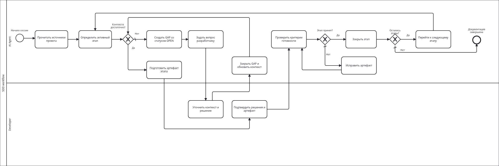

# SDD Framework — фреймворк для разработки технической документации

> **Версия:** 1.9.3

Тема версии: **Профили требований и выбор стандарта разработки**.

Статус публикации: `supported`; immutable tag: `sdd-template-1.9.3`.
Текущий `default_version`: `1.9.3`.

Короткий идентификатор пакета: `sdd-template`.

SDD Framework — набор шаблонов, политик и инструментов для создания технической
документации программных проектов с помощью AI-агентов.

Источник релизов: [Druk83/sdd-template.git](https://github.com/Druk83/sdd-template.git).
Официальный реестр релизов: [release-registry.json](release-registry.json).

## Назначение и возможности

Framework организует переход от исходных материалов к проверяемой технической
документации:

- единые шаблоны, политики и трассируемость требований;
- последовательность этапов от предметной области до тестирования;
- профили требований: ГОСТ 19, ГОСТ 34, SDD и ISO/IEC/IEEE 29148:2018;
- архитектурное и системное проектирование, конфигурации и эксплуатационные требования;
- создание и проверка PlantUML, BPMN и DOT/Graphviz-диаграмм;
- планирование пользовательского интерфейса: пул экранов (screen pool), матрица
  областей отображения (viewport matrix), спецификации и живые эталонные
  прототипы (live reference prototypes).

## Для кого

- **AI-агенты** — используют правила и шаблоны Framework для формирования документов;
- **разработчики** — получают результаты в `docs/requirements/`;
- **аналитики** — фиксируют требования, решения и трассируемость в едином формате.

## Высокоуровневая архитектура (high-level architecture)

Рабочий поток Framework разделён на источники, правила, спецификации, инструменты
и результаты:

```text
.source/ → .manifest/ + .requirements/ → этапы документации → docs/requirements/
                                      ↘ .tools/ — проверки, рендеринг и сборка
```

| Слой | Назначение |
|---|---|
| `.source/` | Подтверждённые исходные материалы проекта |
| `.manifest/` | Политики и обязательные стандарты процессов |
| `.requirements/` | Спецификации этапов и профили требований |
| `.approach/` | Методики и каталоги подходов к проектированию |
| `.tools/` | Проверки, выбор профиля, рендеринг и сборка релиза |
| `docs/requirements/` | Заполненные результаты проекта |
| `.agents/sdd-template-X.Y.Z/` | Установленный пакет Framework в проекте-потребителе |

## Навигация

Основные каталоги имеют собственные индексные README:

- [Спецификации и трек разработки](.requirements/README.md);
- [Спецификации пользовательского интерфейса](.requirements/пользовательский-интерфейс/README.md);
- [Манифесты](.manifest/README.md);
- [Инструменты](.tools/README.md);
- [Методики проектирования](.approach/README.md);
- [Диаграммы](.diagrams/README.md);
- [Задачи](.tasks/README.md).

Ключевые инструменты:

- [сборка и установка релиза](.tools/sdd-template-release/README.md);
- [выбор профиля требований](.tools/requirements-profile/README.md);
- [проверка UI-артефактов](.tools/ui-reference/README.md);
- [рендеринг диаграмм](.tools/plantuml-render/README.md).

## Быстрый старт

### Подключение к проекту

Не копируй корень мета-репозитория целиком в проект-потребитель. Передай
AI-агенту команду:

```text
инициализируй сдд из Druk83/sdd-template.git
```

Для выбора релиза агент получает `README.md` и `release-registry.json` из ветки
`main`, выбирает запись со статусом `supported`, а затем один раз загружает
точный `ref` в `tmp/`. Результат установки размещается только в
`.agents/sdd-template-X.Y.Z/`.

После первичной установки доступны короткие команды:

```text
инициализируй сдд
обнови сдд
вернись на версию X.Y.Z
```

При обновлении агент показывает текущую и доступную версии, проверяет коллизии,
нестандартные файлы и временные каталоги, затем запрашивает подтверждение
очистки. Подробные параметры и сценарии находятся в README инструмента
[sdd-template-release](.tools/sdd-template-release/README.md).

Каталог `docs/requirements/` проекта-потребителя сохраняется полностью и не
заменяется содержимым Framework. Подробные правила установки, обновления,
возврата и миграции пользовательских файлов не дублируются в L0.

### Запуск документирования

Передай агенту:

```text
Ознакомься с .source/, прочитай правила из .agents/sdd-template-X.Y.Z/.manifest/
и шаблон .agents/sdd-template-X.Y.Z/.requirements/трек разработки.md.
Используй AGENTS.md, если он существует, и приступай к составлению
технической документации для этого проекта.
```

Агент задаёт вопросы, проходит этапы по одному и сохраняет результаты в
`docs/requirements/`. Правила остановок, GAP и переходов определены в
[sddmanifest.md](.manifest/sddmanifest.md).

## Workflow: разработчик и агент

1. Разработчик подтверждает источники и границы проекта.
2. Агент изучает `.source/` и задаёт уточняющие вопросы.
3. Агент выполняет один этап и сохраняет результат.
4. Разработчик проверяет результат и разрешает следующий этап.
5. При недостатке данных агент фиксирует пробел в реестре пробелов (GAP tracking)
   и не подменяет решение предположением.

Команды управления:

| Команда | Действие |
|---|---|
| `Продолжай этап [N]` | Перейти к следующему этапу |
| `Исправь: <описание>` | Исправить текущий артефакт |
| `Покажи статус` | Показать состояние документации |

## Рендеринг диаграмм

Для `*.plantuml`, `*.bpmn` и `*.dot` используется
[plantuml-render](.tools/plantuml-render/README.md). Инструмент поддерживает
публичный или локальный Kroki и формирует PNG/SVG согласно правилам диаграмм.

## Этапы документирования

| Этап | Результат |
|---|---|
| Подготовка | Проверка `.source/`, правил и выбранных подходов |
| [1] Предметная область | Глоссарий, акторы и верхнеуровневые сценарии |
| [1] Завершение | Корневой `README.md` проекта-потребителя |
| [2] Обоснование выбора | Стек, ограничения, методология и профиль требований |
| [3] Требования | Требования по выбранному профилю в `docs/requirements/требования/` |
| [4] Домены | Реестр доменов и карточки |
| [5] Сценарии | Карта процесса, мероприятия, контексты и диаграммы |
| [5.a] Пользовательский интерфейс | Пул экранов, спецификации и UI-прототипы |
| [6] Структура данных | Модель данных и ограничения |
| [7] Системное проектирование и архитектура | BL, AL, TL, baseline и эксплуатационные характеристики |
| [8] Структура ПО | Стек, модули и файловая структура |
| [9] Тестирование | Стратегия, тест-кейсы и критерии проверки |
| Финал | Сверка GAP, ссылок, артефактов и итогового README |

Подробный порядок этапов находится в
[треке разработки](.requirements/трек%20разработки.md).

## Структура проекта

```text
.source/                    # исходные материалы
.manifest/                  # политики и обязательные стандарты
.requirements/              # спецификации, трек и профили требований
.approach/                  # методики и каталоги подходов
.tools/                     # инструменты автоматизации
.tasks/                     # текущие задачи и PDD-реестр
.issues/                    # проблемы и дефекты
.diagrams/                  # исходники и обзорные диаграммы Framework
docs/requirements/           # результаты документации проекта-потребителя
.agents/sdd-template-X.Y.Z/ # установленный пакет в проекте-потребителе
```

Профили требований описаны в
[`.requirements/требования/профили.json`](.requirements/требования/профили.json):
`gost-19`, `gost-34`, `sdd` и `iso-29148`. Содержимое `.requirements/` является
шаблонами только для чтения; заполненные результаты создаются в
`docs/requirements/`.

## Диаграмма процесса

<!-- Исходный код: .diagrams/SDD-Development-Process.bpmn -->


Каталог диаграмм последовательности доступен в
[`.diagrams/README.md`](.diagrams/README.md).

## Лицензия

Проект распространяется под лицензией [MIT](LICENSE). Шаблоны и документацию
можно использовать в том числе коммерчески с указанием авторства.

## История изменений

История релизов и ещё не опубликованных изменений находится в
[CHANGELOG.md](CHANGELOG.md). Этот файл не входит в экспортный пакет для
проектов-потребителей.

## Внешние справочники

- [Архитектурные паттерны](https://github.com/Druk83/arch-patterns) — описание архитектурных стилей;
- [Манифесты разработки](https://github.com/Druk83/dev-manifests) — правила для разработчиков и агентов;
- [UI-паттерны](https://github.com/Druk83/ui-patterns.git) — правила выбора паттерна пользовательского интерфейса.
